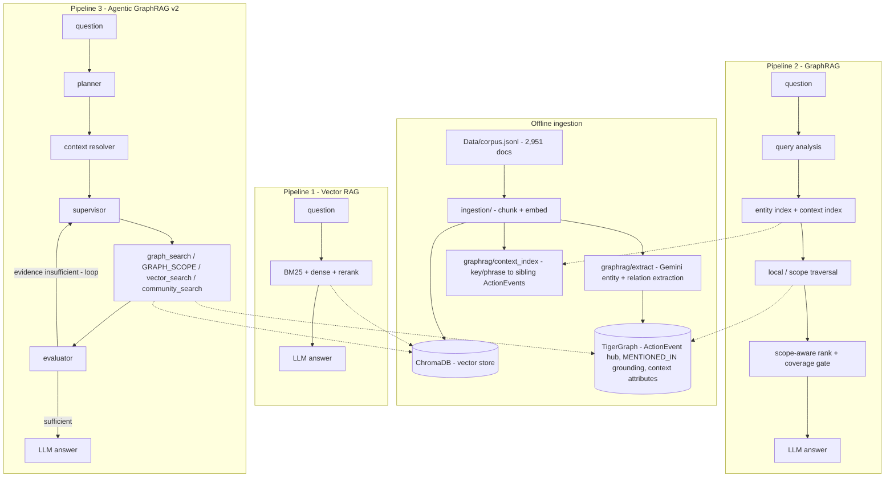

# GraphRAG Hackathon — Three Progressive Retrieval Pipelines

Three retrieval pipelines built progressively over the same Wikipedia (Olympics) corpus, sharing one LLM funnel (`shared/llm_client.py` — Gemini / Azure / Groq / OpenRouter / NVIDIA NIM), one prompt library, one metrics contract (`shared/result.py`), and one run-persistence store (`shared/run_store.py`):

1. **Vector RAG (final)** — `retrieval/` — BM25 + dense retrieval (BGE) + cross-encoder rerank + LLM answer
2. **GraphRAG (final)** — `graphrag/` — TigerGraph knowledge graph (typed event-centric schema) with entity/relation extraction, hierarchy-aware context index, local + scope traversal, and supporting-chunk grounding. Ships with the v2 scope-capable code path.
3. **Agentic GraphRAG v2** — `agentic/` — LangGraph investigation layer that plans, decomposes questions into answer slots, resolves query scope, routes between graph-local / graph-scope / vector / community tools, evaluates evidence per slot, and stops when sufficient

Helper packages: `shared/` (LLM client, prompts, metrics), `ingestion/` (chunking + embedding), `database/` (ChromaDB client), `tests/` (pytest regression suite).

## Architecture



## Results (gpt-5-mini)

Public set — 100 questions, ground truth scored (`answer_match`):

| Pipeline | Accuracy | Avg tokens/q | Avg latency | p50 latency | Steps/q | Strategy changes |
|---|---|---|---|---|---|---|
| Vector RAG (final) | **63%** | 3,328 | ~22 s | ~22 s | — | — |
| GraphRAG (final) | 54% | 6,098 | ~67 s | ~45 s | — | — |
| Agentic GraphRAG v2 | **66%** | 20,394 | ~170 s | ~101 s | 2.23 | 35% |

*(Agentic v1 on the same public set, for reference: 58% accuracy, 12,794 tokens/q, 1.95 steps/q, 28% strategy changes — v2 adds +8 points accuracy and scope coverage at ~1.6x tokens.)*

Hidden set — 50 questions; runtime metrics only, scoring is done by the organizers (`results/hidden_predictions/` holds the per-question answers, token counts, and agent traces):

| Pipeline | Avg tokens/q | Avg latency | Steps/q |
|---|---|---|---|
| Vector RAG (final) | 3,348 | ~21 s | — |
| GraphRAG (final) | 6,976 | ~75 s | — |
| Agentic GraphRAG | 15,265 (v1 run; v2 hidden run in flight) | — | 2.46 |

Full per-question records: `results/<pipeline>/<eval_set>_<timestamp>.json`. Interactive comparison: `python scripts/build_dashboard.py` → `dashboard/index.html` (self-contained, opens via file://).

**Known open item:** exact counting over ~60-event scopes (aggregation questions) — the scope traversal now discovers 47–68 sibling events with `scope_coverage` reporting (v1 refused outright), but a per-event fact rollup in the context builder is needed to count reliably. See `progress.md` §13.

## v2 architecture (what changed)

Design doc: `graph_agentic_architecture_v2.md`. Four pieces:

- **Hierarchy-aware context index** (`graphrag/context_index.py`, offline + cached, zero LLM): maps context keys/phrases to sibling ActionEvents along the graph hierarchy, so "2018 biathlon events" resolves to the *set* of events, not one vertex.
- **Scope traversal** (`graphrag/scope.py`, `traverse.py`): for set/aggregation questions the traversal expands from a detected scope root to all sibling members and pulls the union of their grounding chunks; `scope_coverage` reports what was covered.
- **Query-aware coverage gate** (`graphrag/rank.py`): ranks context by scope relevance and decides whether collected evidence plausibly covers the question before answering.
- **Agent action `GRAPH_SCOPE`** (Pipeline 3): the agent can request a scope expansion when it detects an under-covered collection question, with investigated-context guards to prevent loops. Pipeline 2 ships with the same scope-capable retrieval engine, so both pipelines share one code path.

## Repo layout

```
shared/      LLM client, prompts, metrics, result contract, run store
ingestion/   corpus loading, chunking, embedding, one-time Chroma ingestion
retrieval/   Pipeline 1: BM25, dense, reranker, full vector pipeline + eval
database/    ChromaDB client
graphrag/    Pipeline 2: ontology, extraction (checkpointed), dedup, TigerGraph load,
             context metadata + context index + scope module, retrieval pipeline + eval
agentic/     Pipeline 3: planner, context resolver, tools (graph/scope/vector/community),
             evaluator, supervisor, LangGraph loop + eval
tests/       pure-function regression tests (pytest; no TG/LLM needed)
scripts/     build_hidden_predictions.py, build_dashboard.py (submission artifacts)
dashboard/   self-contained results dashboard (generated by scripts/build_dashboard.py)
Data/        eval sets (public, hidden, v2 query classes); corpus.jsonl not committed
results/     saved evaluation runs (self-describing JSON) + hidden_predictions/
context.md   project spec / architecture source of truth
graph_agentic_architecture.md      agentic pipeline design
graph_agentic_architecture_v2.md   v2 retrieval architecture (hierarchy-aware)
progress.md  full build log: what was built, errors, fixes, findings
```

## Setup

```bash
python -m venv ragvenv && ragvenv/Scripts/activate   # Windows
pip install -r requirements.txt
copy .env.example .env   # then fill in keys (see below)
```

`.env` keys: `GOOGLE_API_KEY` (Gemini), `AZURE_OPENAI_API_KEY/ENDPOINT/DEPLOYMENT`,
`GROQ_API_KEY`, `OPENROUTER_API_KEY`, `NVIDIA_API_KEY`,
`TIGERGRAPH_HOST/GRAPHNAME/SECRET`, and `LLM_PROVIDER` (`auto` | `gemini` | `azure` | `groq` | `openrouter`).
The corpus (`Data/corpus.jsonl`) is not committed — place it in `Data/` before ingesting.

## Running

```bash
# 0. One-time corpus ingestion -> ChromaDB
python -m ingestion.run_ingest --full

# 1. GraphRAG ingestion: chunks -> Gemini entity/relation extraction -> TigerGraph
python -m graphrag.ingest_pipeline --full --eval-first --skip-load   # extraction only
python -m graphrag.schema && python -m graphrag.ingest_pipeline --full --eval-first  # + graph load

# 1b. v2 context index (offline, zero LLM): context key -> sibling ActionEvents
python -m graphrag.context_index --build

# 1c. (optional) backfill context attributes onto the TigerGraph graph
python -m graphrag.backfill_context            # schema change + attribute upserts
python -m graphrag.backfill_context --dry-run

# 2. Ask a question (any pipeline)
python -m retrieval.vector_pipeline "question"
python -m graphrag.retrieval_pipeline "question"            # auto: local vs scope traversal
python -m graphrag.retrieval_pipeline "question" --mode scope
python -m agentic.agent "question" --trace

# 3. Evaluations (saved to results/)
python eval_all.py                       # all 3 pipelines x public/hidden, sequential, saved
python -m graphrag.acceptance            # v2 query classes A-G gate (Pipeline 2)
python -m graphrag.acceptance --agentic  # same classes through Pipeline 3

# 4. Unit tests (no TigerGraph / no LLM needed)
pytest tests/

# 5. Submission artifacts
python scripts/build_hidden_predictions.py   # results/hidden_predictions/ (JSON + CSV)
python scripts/build_dashboard.py            # dashboard/index.html (self-contained)
```

See `progress.md` for the complete build log, `context.md` for the original spec, and
`graph_agentic_architecture_v2.md` for the v2 design (context index, scope traversal,
coverage gate, agentic `GRAPH_SCOPE`).
